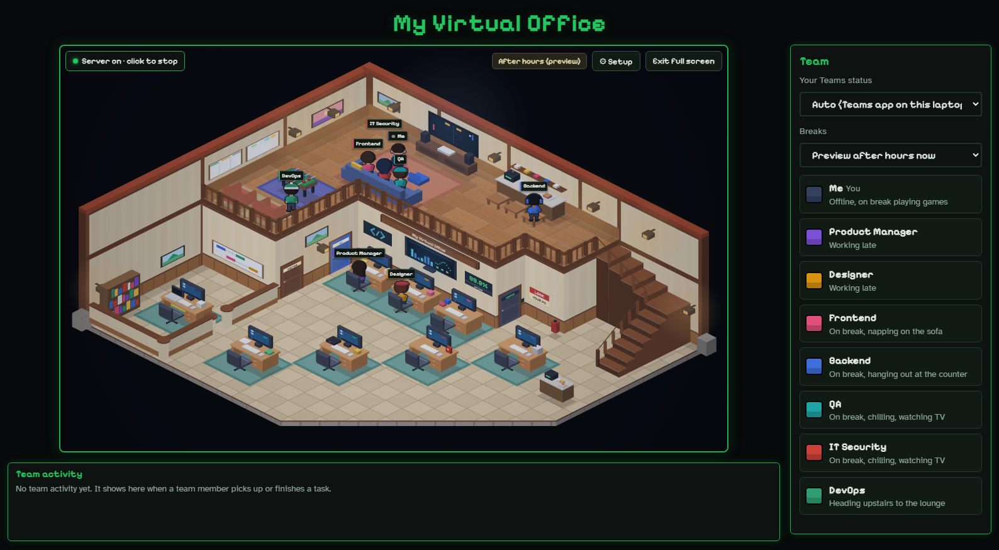

# Virtual Office

Virtual Office is a local pixel-art view of AI activity on your computer. A timber hall fills the scene: seven team roles work downstairs, and the team visits the mezzanine lounge during breaks. The office reacts to Claude Code, Codex, ChatGPT, and claude.ai activity where their integrations are available.



The characters visualize activity; they are not separate AI agents. The role skills provide instructions to compatible AI tools. A skill hint asks a tool to use a matching skill, but it cannot guarantee that the tool does so.

## Features

- Isometric office with animated characters, role-specific screens, break activities, and a 30 fps cap.
- Local activity history with request wording masked.
- Setup for office name, team names and colors, hours, skills, and connections.
- Claude Code and Codex hooks, plus an optional Chrome extension for ChatGPT and claude.ai.
- Windows installer built from tracked source files; Node.js is bundled in the installer.

## Run from source

Install Node.js 22 or newer. On Windows, run:

```powershell
git clone https://github.com/Rudisatria/virtual-office-agent.git
cd virtual-office-agent
npm.cmd start
```

Open `http://localhost:4321` in **Chrome**. Setup is at `/setup`. The server binds to `127.0.0.1`. This source checkout does not install hooks or change startup settings until you select those actions in Setup.

To run against isolated test settings, set `PORT=4399`, `OFFICE_DATA`, and `OFFICE_HOME` to temporary folders, and create `home/.claude` and `home/.codex` first. See the scripts in `tests/` for examples.

## Connect AI tools

Open Setup and choose the connections you want. It can install the office's role skills and hooks for Claude Code or Codex. Existing same-named skills that the office did not create are left alone. Start a new AI session after changing hooks or skills.

For ChatGPT and claude.ai, load the unpacked `extension/` folder in Chrome. A web skill hint can be enabled in Setup; it appends a short request to use the matching skill if available. Upload the skill ZIP files yourself if you want those websites to have the skill contents. The extension's hint on live sites still needs real-site verification because their editors change.

## Privacy and security

The office server only listens on localhost and rejects unexpected `Host` values. Mutating endpoints use `X-Office` headers, and `/hook` accepts JSON only. Activity history is stored locally and masks request wording. Office settings and edited skills are kept in the user's data folder outside this repository.

The optional Chrome extension communicates with the local office and observes activity on supported AI websites. Those websites receive the messages you send them, including an optional skill hint. Fonts are requested from Google Fonts when the page loads. Review the extension permissions and Setup choices before enabling them.

Do not put secrets in skills or commit settings, logs, or screenshots containing personal data. Report security issues privately to the maintainer rather than posting exploit details in a public issue.

## Build and test

The project has no npm runtime dependencies. On Windows, `npm.cmd run installer:build` builds `dist/VirtualOfficeSetup.exe` using the .NET Framework compiler and the current Node executable. It packages Git-tracked app files, so review staged files before building. The installer is not committed to this repository.

Run the isolated scripts in `tests/` one at a time; several use port 4399. The visual tests use Chrome with a reused test profile. `node tests/person-occlusion.js` checks character poses and `node tests/label-layout.js` checks crowded labels.

## Feedback

Please open an issue with the behavior you saw, what you expected, and the relevant app or browser version. Remove account names, prompt text, logs, and other personal information before posting.
